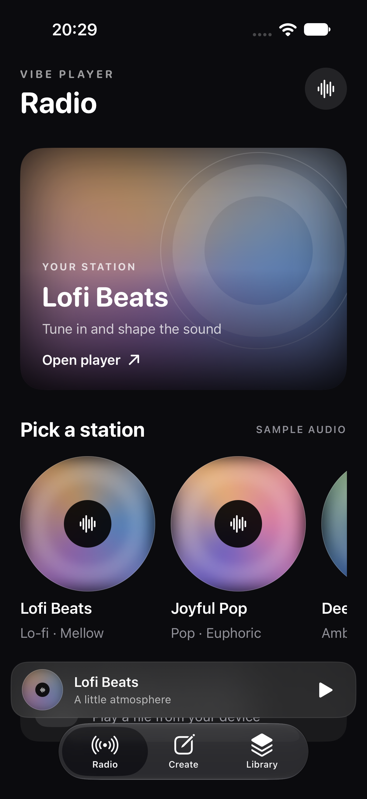
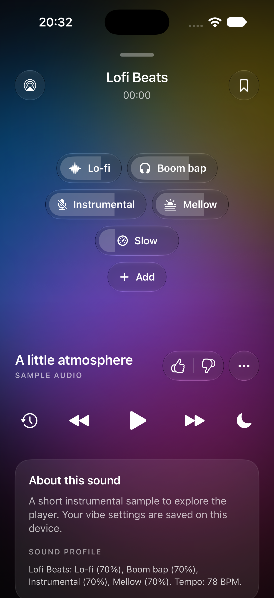
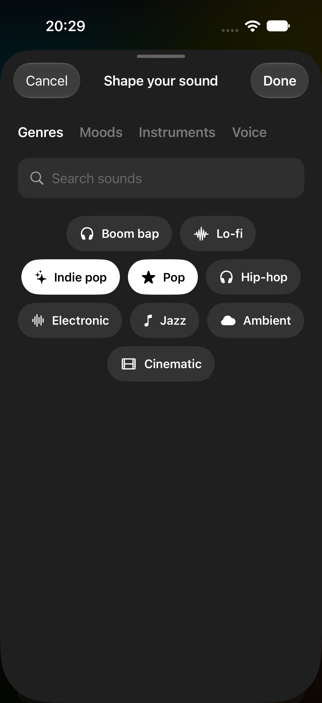
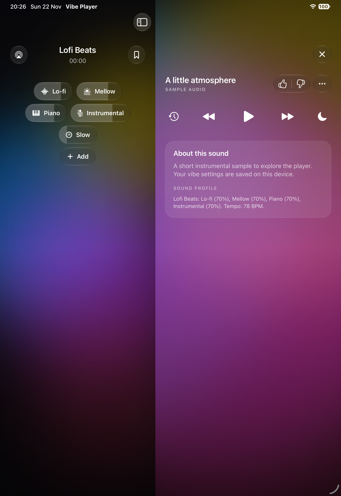

# infetit radio

**An open-source AI music player and generative radio for iPhone, iPad, and Mac.** Describe a song or shape a station, then make music locally with YuE2, SwiftUI, Core ML, and Metal.

infetit radio is an experimental native app for exploring what a music player feels like when you can change the music itself. Choose a mood, adjust the instruments, and let Radio prepare the next track—or start with your own idea and lyrics.

<p align="center">
  
  &nbsp;
  
  &nbsp;
  
</p>
<p align="center"><em>Pick a station. Shape the sound. Hear what comes next.</em></p>

> **Early prototype:** Use [Quick install](#quick-install) to build infetit radio and download the models for local music generation.

## What you can do

- **Make your own radio.** Pick a station and adjust its genre, mood, instruments, voice, and tempo. Radio prepares songs in the background and crossfades to the next one when it is ready.
- **Create songs from an idea.** Describe the sound, provide lyrics or ask a writing model to help, and follow generation progress in the Create view.
- **Listen as audio becomes available.** Early playback builds a buffer while generation continues; High quality uses full acoustic context. Availability depends on your installed assets and device.
- **Keep the songs you love.** Created songs are saved to your library. Like a Radio track to keep it; unsaved Radio renders are temporary.
- **Feel at home on Apple devices.** A native SwiftUI interface adapts to iPhone, iPad, and Mac, with a responsive player, keyboard controls on Mac, and Reduce Motion support.

The station controls describe the sound in a prompt. They are creative cues, not precise audio mixing or tempo controls.

## See it on iPad

<p align="center">
  
</p>

These screenshots show an earlier prototype using sample audio. The current generation features require model setup described below.

## Get started

### Requirements

- Xcode with a recent Swift toolchain; the packages use Swift 6.2 or later.
- iOS or iPadOS 18+, or macOS 15+.
- For music generation, compatible YuE2 model assets prepared for the target device. The model weights and compiled assets are **not** included in this repository.

### Quick install

From a clone of this repository on an Apple silicon Mac with Xcode installed:

```sh
python3 Scripts/install_models.py --build-app
```

This installs infetit radio in `~/Applications` and downloads the Mac music and songwriting models. Use `python3 Scripts/install_models.py` to install the models for an existing build. Add `--all` for the optional full-precision and reference-audio weights.

For iPhone or iPad, run the project once from Xcode using your signing team. Close the app on the device, and run this from the Mac:

```sh
xcrun devicectl list devices
python3 Scripts/install_models.py --device YOUR_DEVICE_ID
```

Pass `--bundle-id YOUR_BUNDLE_ID` if you changed the bundle identifier for signing. Reopen the app after the models finish copying. The command installs the platform-appropriate models. See the runtime instructions below to enable the optional native Metal renderer.

The installer verifies SHA-256 hashes and downloads from pinned Hugging Face revisions. The [infetit radio Core ML repository](https://huggingface.co/ferdinandl007/vibeplayer-yue2-coreml) supplies the compiled bundles. The original publishers supply the GGUF and LFM3 weights. The music and reference weights are under CC BY-NC 4.0, and LFM3 uses the [LFM Open License](https://huggingface.co/LiquidAI/LFM3-1.7B-MLX-4bit).

### Build the app

1. Open `VibePlayer.xcodeproj` in Xcode.
2. Select the **VibePlayer** scheme and your iPhone, iPad, or **My Mac**.
3. Choose your signing team if needed and run the app.

You can explore the interface and its bundled sample audio without a model. To generate songs, prepare and install the assets below.

### Set up local music generation

The app looks for an indexed version 3 bundle named `YuE2MetalAssets` in its app resources or Application Support. It uses Metal for song tokens and Core ML for prompt prefill, acoustic synthesis, and waveform decoding. Export assets for the platform you intend to run on.

1. Obtain the [audio.cpp YuE2 GGUF checkpoint](https://huggingface.co/audio-cpp/Yue2-3B-GGUF), including the required weights and sidecars.
2. Follow the [YuE2CoreML export and Metal indexing instructions](Packages/YuE2CoreML/README.md#metal-decoder-preview).
3. Install the resulting `YuE2MetalAssets` directory in the app bundle or its Application Support directory. Keep the complete bundle together.

On Apple silicon Macs, the `YuE2NativeAssets` directory in Application Support enables the audio.cpp Metal runtime. High Quality and Radio prefer the optimized `libaudiocpp-pcm-fast.dylib` and fall back to `libaudiocpp-pcm.dylib` when needed. Both use eight synthesis steps and full-song context. The indexed model still uses Core ML for prompt prefill. See [YuE2Kit's runtime and asset instructions](Packages/YuE2Kit/README.md#runtime-and-weights).

On physical iPhones and iPads, builds with the embedded `YuE2Audio.framework` and the native weights also use audio.cpp Metal for High Quality and Radio. Composition finishes before the native acoustic session loads. The app uses the indexed Core ML acoustic and waveform graphs when the native runtime or weights are unavailable. [Build and provision the iOS runtime](Packages/YuE2Kit/README.md#iphone-and-ipad)

Model assets can require several gigabytes. The separately distributed YuE2 weights use **CC BY-NC 4.0**; check the [model card](https://huggingface.co/m-a-p/YuE2-3B) before using or distributing them.

## How it works

### Radio

A station supplies the style, voice, and tempo. Each song gets its own title, seed, and arrangement cues. The writing model can draft original lyrics for vocal tracks. Radio starts playing as soon as its first song is ready and keeps rendering until it has ten songs queued. On Mac, songs run from 2:00 to 3:28 with eight full-context acoustic steps. **Prepare songs** can fill the queue while playback is paused.

Sound changes apply to the next render. Ready songs keep playing until the updated one is available, then Radio crossfades into it. **Previous song** replays the previous track and returns to the interrupted track afterward. Mac playback and rendering can continue with the display locked. On iPhone and iPad, the ready queue plays while locked and generation resumes when the app is active again.

### Create

Create sends the sound description and lyrics to YuE2 as separate fields. The app checks the model's token budget and can ask the writing model to shorten a prompt. You can queue another idea while a song is rendering and cancel a render in progress. On iOS, Create is capped at 4,200 semantic frames, or 2:48 of audio.

In the **Metal** menu, **Follow style closely** is on by default and sets YuE2's text guidance to 1.2. Turn it off to use 1.01. **Clear lead vocals** is optional and asks for a more forward lead, clear diction, and light vocal reverb. These settings apply to newly queued songs.

**Early playback** generates overlapping sections and starts after building a buffer. If generation falls behind, playback fades out and resumes from the same position when enough audio is ready. **High quality** is the default on Mac, iPhone, and iPad. It synthesizes with full acoustic context and starts when the waveform decoder has built a buffer. Mac Create defaults to **Full song**, allowing an ending between 2:00 and 3:28. Compatible models also offer **Extended** for 3:30 to 4:16. Create remembers the rendering choice separately for vocal songs and instrumentals.

Use **Remix in Create** from a generated song’s Library menu to keep its original audio up to a chosen point and blend into a new ending. On Mac, the optional reference encoder can also open older Library songs and local recordings. It listens to up to the first 60 seconds and extracts musical context locally. The **Reference** button also accepts a file of zero-based YuE2 codes. [Reference encoder and weight files](https://hangry-labs.github.io/yue2/docs/MODELS.html)

An explicit artist request such as “I want a Taylor Swift song” opens released tracks in Apple Music. Choose **Create an original song instead** to use the prompt for generation.

### Writing and privacy

Music generation runs locally using the installed model. For songwriting, you can supply your own lyrics or configure a Gemini API key in Create. The key is stored in the device Keychain; when configured, writing requests are normally sent to Gemini over HTTPS. If there is no key or the connection fails, the app uses Apple's on-device Foundation Model when available.

## Project structure

- [`VibePlayer/`](VibePlayer/) — SwiftUI app, player, Radio, Create, and generation integration.
- [`Packages/YuE2CoreML/`](Packages/YuE2CoreML/) — reusable Swift package, Metal decoder, Core ML renderer, and asset exporter.
- [`Packages/YuE2Kit/`](Packages/YuE2Kit/) — macOS audio.cpp integration and benchmark.
- [`Tests/`](Tests/) and [`VibePlayerUITests/`](VibePlayerUITests/) — focused checks and UI tests.

To run the standalone music prompt checks on a Mac:

```sh
xcrun swiftc -parse-as-library VibePlayer/MusicGeneration.swift Tests/MusicPromptBuilderChecks.swift -o /tmp/vibe-prompt-checks
/tmp/vibe-prompt-checks
```

See the package READMEs for additional tests, export options, and runtime details.

## Contributing

Issues, ideas, and pull requests are welcome. If you encounter a generation problem, include the device, OS, model asset configuration, and steps to reproduce it. Please avoid sharing API keys or private audio.

## License

infetit radio is available under the [MIT License](LICENSE). Third-party components have their own terms: YuE2Kit includes an audio.cpp ABI header under the [Apache License 2.0](Packages/YuE2Kit/LICENSE.audio.cpp), and the separately obtained [YuE2 weights](https://huggingface.co/m-a-p/YuE2-3B) are licensed under CC BY-NC 4.0.
